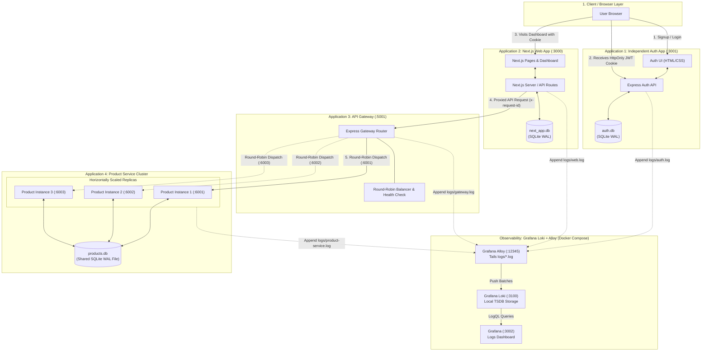

# Scalable Multi-Application Architecture with Centralized Logging

> **A minimal, beginner-friendly distributed system demonstrating independent authentication, a Next.js application, an Express API Gateway with Round-Robin load balancing, three replicated Node.js microservice instances, SQLite database isolation, and Grafana Loki + Alloy centralized logging.**
>
> **Project Source of Truth:** See [PROJECT_CONTEXT.md](./PROJECT_CONTEXT.md) for the verified architecture audit, target 3-application requirements, centralized auth/logging design, and implementation roadmap.
>
> **Manual Execution & Testing Runbook:** See [MANUAL_TESTING_GUIDE.md](./MANUAL_TESTING_GUIDE.md) for exact startup commands, signup/login steps, browser SSO walkthrough, feature testing, Grafana LogQL queries, and troubleshooting.

---

## 1. Project Overview & Core Architecture

This project is a multi-tier, distributed system built without unnecessary abstractions. It demonstrates how modern web systems decouple responsibilities, protect databases behind domain boundaries, route traffic through a reverse proxy API Gateway, scale stateless microservices horizontally, and aggregate logs centrally into Grafana Loki using Grafana Alloy.

### Core Architectural Pillars
1. **Centralized Authentication Application (Port 3001):**
   - Own UI (`login.html`, `signup.html`), Express backend (`src/server.ts`, `src/security.ts`), and SQLite database (`auth.db`).
   - Passwords hashed using `bcryptjs` (10 rounds).
   - Issues cryptographically signed JSON Web Tokens (JWT) stored exclusively in **`HttpOnly` cookies** (`SameSite=Lax`, `Path=/`, inaccessible to JavaScript).
   - Strict CORS allowlist (`http://localhost:3000`, `http://localhost:3003`, `http://localhost:3004`, `credentials: true`) and validated `redirect_uri` flow on `/login`, `/signup`, and `POST /api/auth/logout` (preventing open redirects).
   - Requires `JWT_SECRET` in `.env` (and `ALLOWED_ORIGINS` optionally); fails fast if `JWT_SECRET` is missing.
   - Zero cross-database queries: applications verify JWTs statelessly in-memory and never connect to `auth.db`.
2. **Next.js Web Application (Port 3000):**
   - Main user dashboard and product browsing interface.
   - Verifies JWT sessions statelessly in-memory using the shared JWT secret.
   - Stores user preferences in its own isolated SQLite database (`next_app.db`).
3. **API Gateway (Port 5001):**
   - Single entry point for external backend requests (`/api/v1/products`).
   - Implements **Round-Robin load balancing** across the 3 product replicas.
   - Tracks incoming requests with correlation IDs (`x-request-id`).
   - Performs background health checks (every 5 seconds) to eject failed instances and automatically re-admit recovered instances.
   - Includes a 503 circuit-breaker response if all backend instances are offline.
4. **Product Microservice Cluster (Ports 6001, 6002, 6003):**
   - Exactly **three instances** running from **one shared codebase** (`apps/services/product-service`).
   - Differentiated dynamically via environment variables `PORT` and `INSTANCE_ID`.
   - Safely read and write to a single logical `products.db` configured in SQLite Write-Ahead Logging (`WAL`) mode with busy timeout handling.
5. **Centralized Logging (Grafana Loki + Grafana Alloy):**
   - Structured JSON logging to `logs/*.log` with dual terminal output.
   - Grafana Alloy agent mounts host `./logs` as read-only and pushes to Grafana Loki (`:3100`).
   - Grafana (`:3002`) provides a unified Logs Dashboard (`arch-centralized-logs`) with full LogQL filtering.

---

## 2. High-Level Architecture Diagram



---

## 3. Clean Final Folder Structure

```
ARCH PROJECT/
├── package.json               # Root monorepo workspace configuration
├── package-lock.json
├── tsconfig.base.json         # Base TypeScript configuration
├── README.md                  # Complete project documentation
├── LAST_README.md             # Hinglish Manager presentation script & code guide
│
├── apps/
│   ├── auth/                  # Independent Auth Application (:3001)
│   │   ├── package.json
│   │   ├── tsconfig.json
│   │   ├── public/            # Static Login & Signup HTML UI
│   │   │   ├── login.html
│   │   │   └── signup.html
│   │   ├── data/
│   │   │   └── auth.db        # Auth SQLite database (Users & Hashes)
│   │   └── src/
│   │       ├── server.ts      # Auth Express endpoints (signup, login, logout, verify)
│   │       ├── db.ts          # SQLite connection & bcrypt user helpers
│   │       └── logger.ts      # Structured JSON logger (masks emails, records IST)
│   │
│   ├── web/                   # Next.js Application (:3000)
│   │   ├── package.json
│   │   ├── tsconfig.json
│   │   ├── next.config.js
│   │   ├── data/
│   │   │   └── next_app.db    # Next.js SQLite database (User Preferences)
│   │   └── src/
│   │       ├── app/           # App Router pages & API routes
│   │       ├── components/    # ProductsCatalog & PreferencesForm UI
│   │       └── lib/           # db.ts, auth.ts, logger.ts
│   │
│   ├── gateway/               # API Gateway (:5001)
│   │   ├── package.json
│   │   ├── tsconfig.json
│   │   └── src/
│   │       ├── server.ts      # Reverse proxy router, correlation ID & fault injection
│   │       ├── loadbalancer.ts# Round-Robin algorithm & background health checker
│   │       └── logger.ts      # Gateway JSON logger
│   │
│   └── services/
│       └── product-service/   # Single Shared Product Microservice Codebase
│           ├── package.json
│           ├── tsconfig.json
│           ├── data/
│           │   └── products.db# Shared products catalog SQLite database
│           └── src/
│               ├── server.ts  # Express CRUD endpoints (:6001, :6002, :6003)
│               ├── db.ts      # SQLite connection & catalog queries
│               └── logger.ts  # Product service JSON logger
│
├── logs/                      # Mounted read-only into Grafana Alloy
│   ├── auth.log
│   ├── gateway.log
│   ├── product-service.log
│   └── web.log
│
├── monitoring/                # Minimal Docker Compose Logging Stack
│   ├── docker-compose.yml     # Loki (:3100), Alloy (:12345), Grafana (:3002)
│   ├── loki/
│   │   └── loki-config.yml    # Loki local TSDB storage & 7-day retention
│   ├── alloy/
│   │   └── config.alloy       # Alloy River pipeline (scrapes ./logs -> Loki)
│   └── grafana/
│       └── provisioning/
│           ├── datasources/
│           │   └── loki.yml   # Provisions Loki as default datasource
│           └── dashboards/
│               ├── dashboards.yml
│               └── definitions/
│                   └── logs-dashboard.json # Unified Logs Dashboard (Asia/Kolkata)
│
└── scripts/
    ├── runner.js              # Multi-process runner for all applications
    ├── start-all.sh           # Starts all 4 apps & 3 replicas in background
    ├── stop-all.sh            # Gracefully kills all service ports (3000-6003)
    ├── start-monitoring.sh    # Launches Loki, Alloy, Grafana via Docker Compose
    ├── stop-monitoring.sh     # Stops monitoring containers
    ├── status-monitoring.sh   # Prints container & Loki readiness status
    └── test-all.sh            # Master automated end-to-end test suite
```

---

## 4. Port Allocation Table

| Service / Component | Port | Description | Database Ownership |
| :--- | :--- | :--- | :--- |
| **Next.js Web App** | `3000` | E-Commerce Storefront (3 products via Gateway + Cart) | `next_app.db` |
| **Auth Service** | `3001` | Independent authentication & UI | `auth.db` |
| **Notes Web App** | `3003` | Express Notes CRUD App (`npm run start:notes`) | `notes.db` |
| **Hybrid Frontend** | `3004` | Next.js Task Manager UI (`npm run start:hybrid:frontend`) | *Calls `:3005`* |
| **Hybrid Backend** | `3005` | Express Tasks REST API (`npm run start:hybrid:backend`) | `hybrid.db` |
| **API Gateway** | `5001` | Reverse proxy & Round-Robin | *Stateless (No DB)* |
| **Product Replica 1**| `6001` | Product Microservice Instance 1 | `products.db` (Shared) |
| **Product Replica 2**| `6002` | Product Microservice Instance 2 | `products.db` (Shared) |
| **Product Replica 3**| `6003` | Product Microservice Instance 3 | `products.db` (Shared) |
| **Grafana UI** | `3002` | Centralized Logs Dashboard | *Reads Loki* |
| **Grafana Loki** | `3100` | Local log ingestion & storage | `loki-data` (Volume) |
| **Grafana Alloy** | `12345`| Log collection agent | *Reads `./logs` (Read-Only)* |

---

## 5. Startup & Shutdown Commands

```bash
# 1. Start Docker Logging Stack (Loki, Alloy, Grafana)
npm run start:monitoring
# (Or: ./scripts/start-monitoring.sh)

# 2. Check Logging Stack Status
npm run status:monitoring
# (Or: ./scripts/status-monitoring.sh)

# 3. Start All Application Services (Auth, Next.js, Gateway, 3 Product Replicas)
npm run start:all
# (Or: node scripts/runner.js)

# 4. Run Complete Automated Master Test Suite
npm run test:all

# 5. Stop All Applications
npm run stop:all

# 6. Stop Monitoring Containers
npm run stop:monitoring
```

---

## 6. How to Search Logs in Grafana

1. Open **Grafana** at `http://localhost:3002` (Credentials: `admin` / `admin`).
2. The **Application Centralized Logging Dashboard** (`http://localhost:3002/d/arch-centralized-logs`) opens directly as the default home dashboard in **Asia/Kolkata (IST)** timezone.
3. Filter by **Service** (`auth-service`, `notes-app`, `web-app`, `hybrid-frontend`, `hybrid-backend`, `api-gateway`, `product-service`) or **Event** using the top dropdowns.
4. Filter by **Request ID Filter** (e.g., `req_e2e_trace_...`) to trace a single request across Next.js (`web-app`), API Gateway (`api-gateway`), and Product Service (`product-service`).
5. Direct LogQL queries in **Grafana Explore** (`http://localhost:3002/explore`):
   - All logs: `{job="arch-applications"}`
   - Failed logins: `{service="auth-service", event="LOGIN_FAILED"}`
   - Successful logins: `{service="auth-service", event="LOGIN_SUCCESS"}`
   - Notes actions: `{service="notes-app", event=~"NOTE_CREATED|NOTE_UPDATED|NOTE_DELETED"}`
   - E-Commerce cart actions: `{service="web-app", event=~"PRODUCTS_LISTED|CART_ITEM_ADDED|CART_CHECKOUT"}`
   - Hybrid task actions: `{service="hybrid-backend", event=~"TASK_CREATED|TASK_COMPLETED|TASK_DELETED"}`
   - Round-Robin replica distribution: `sum by (instance_id) (count_over_time({service="product-service", instance_id=~"product-1|product-2|product-3", event="REQUEST_RECEIVED"}[1h]))`
   - Errors: `{job="arch-applications", status_code=~"4..|5.."}`

---

## 7. Repeatable Manager Live Demonstration

1. Start monitoring (`npm run start:monitoring`) and applications (`npm run start:all`), using `localhost` consistently in your browser.
2. Open **Grafana** at `http://localhost:3002/d/arch-centralized-logs` (`admin` / `admin`, auto-refresh `2s`).
3. Visit `http://localhost:3003` (Notes App) unauthenticated → redirected to Central Auth (`http://localhost:3001/login?redirect_uri=...`). Sign up / Log in once.
4. Create a note on `:3003` → observe `LOGIN_SUCCESS` and `NOTE_CREATED` in Grafana.
5. Navigate to `http://localhost:3000` (E-Commerce Store) → accesses immediately without re-login; add a product to cart → observe `PRODUCTS_LISTED` and `CART_ITEM_ADDED` in Grafana.
6. Navigate to `http://localhost:3004` (Hybrid Task Manager) → accesses immediately without re-login; create a task → observe `TASK_CREATED` in Grafana.
7. Copy a `request_id` from the E-Commerce UI or logs into Grafana's **Request ID Filter** → inspect correlated logs across `web-app`, `api-gateway`, and `product-service`.
8. Click **Sign Out** in any app → verify all three apps (`:3000`, `:3003`, `:3004`) reject access and redirect back to Central Auth.
