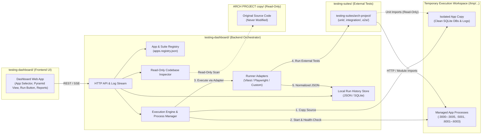

# Technical Architecture Design (`ARCHITECTURE.md`)

> **Phase:** Phase 1 — Technical Architecture Design (Approved with Corrections)  
> **Status:** Approved MVP Architecture (Ready for Implementation Planning)  
> **Scope:** Architectural design only. No dashboard, backend, or test suite code has been implemented, no dependencies installed, and `ARCH PROJECT copy/` remains unmodified.

---

## 1. Baseline from Root `README.md`

From [README.md](./README.md), the confirmed foundation is:
- **Goal:** A centralized, local-first testing platform that inspects applications, recommends Testing Pyramid strategies, manages external test suites, triggers real test execution from a **Run** button via a backend service, and displays centralized reports.
- **Three-Repository Boundary:**
  - `ARCH PROJECT copy/` — Read-only sample target application (7 npm workspaces: `@arch/auth`, `@arch/web`, `@arch/notes`, `@arch/hybrid-frontend`, `@arch/hybrid-backend`, `@arch/gateway`, `@arch/product-service`; TypeScript, Express 5, Next.js 16, SQLite/`better-sqlite3`; no existing unit/integration/E2E framework).
  - `testing-dashboard/` — Centralized Dashboard UI + Backend Execution & Analysis Service.
  - `testing-suites/` — Externally maintained test suites, completely decoupled from target application repositories.

---

## 2. High-Level Connection Architecture (Proposed)

To keep the MVP simple and reliable, `testing-dashboard/` is designed as **one cohesive local application** with two clear internal layers:
1. **Dashboard Frontend (UI):** Runs in the browser; never accesses the filesystem or spawns processes.
2. **Platform Backend Service (API + Orchestrator):** Runs locally on Node.js; reads target apps in read-only mode, manages isolated execution workspaces, spawns external test runners, cleans up processes, and stores normalized results.



### How the Three Folders Connect Without Coupling
- **`testing-dashboard/`** holds a lightweight registry (e.g., `apps.registry.json`) mapping an `appId` (such as `arch-project`) to:
  - `sourcePath`: `../ARCH PROJECT copy` (treated strictly as read-only).
  - `suitePath`: `../testing-suites/arch-project`.
  - `runtime`: optional startup/health-check metadata (or auto-detected defaults).
- **`testing-suites/`** is a standalone project with its own `package.json` and test dependencies (e.g., Vitest, Playwright). Target applications never need test dependencies installed in their own `package.json`.
- **`ARCH PROJECT copy/`** has zero knowledge of `testing-dashboard/` or `testing-suites/`.

---

## 3. Executing External Test Suites Without Modifying Target Source

Depending on the Testing Pyramid layer, external tests interact with the target application in two ways:

1. **Unit Tests (Code-Level):**
   - External test files in `testing-suites/arch-project/unit/` import target functions/modules directly from the **isolated workspace copy** (passed via an environment variable like `TARGET_APP_DIR`) using TypeScript/Node module resolution.
   - Because `testing-suites/` has its own test runner and `tsconfig`, no test files, `jest.config`, or `vitest` packages are ever added to `ARCH PROJECT copy/`.
2. **Integration / API & E2E Tests (Runtime-Level):**
   - External tests communicate with the target application over **HTTP/Browser** against local ports (`:3000`, `:3001`, `:3003`, `:3004`, `:3005`, `:5001`, `:6001–:6003`).
   - Because communication is purely over network/UI boundaries, the target application requires zero code changes or test hooks.

---

## 4. Execution Lifecycle: Workspaces, Startup, Cleanup & Reports

When the user clicks **Run** on the dashboard, the Backend Execution Engine executes a deterministic 6-step lifecycle:

### Step 1: Temporary Isolated Execution Workspace
- **Why:** `ARCH PROJECT copy/` uses local SQLite databases (`*.db`) and writes to `logs/*.log`. Running tests directly against `ARCH PROJECT copy/` would mutate its databases, logs, or dependencies.
- **How:** For each run (`runId`), the backend creates a temporary directory (e.g., `/tmp/testing-platform-runs/<run-id>/app`).
- **Source, Dependencies & Environment Isolation:**
  - **Source & Data:** Copy source files, config files, and clean/initial `data/` into the temp workspace. Never write back to `ARCH PROJECT copy/`.
  - **Dependencies (`node_modules`):** Do **not** symlink `node_modules` into `ARCH PROJECT copy/`, because a symlink is writable and could allow a test or build step to mutate the original repository's dependencies. Instead, copy `node_modules` into the isolated workspace (or run `npm ci` inside the temp workspace when needed) so the original `ARCH PROJECT copy/node_modules` is never touched.
  - **Environment Variables (`.env`):** Never blindly copy the target application's `.env` file. Instead, use an **explicit environment-variable configuration mechanism** defined in the platform's app registry / test profile (e.g., `testEnv` overrides or a `.env.test` template with ephemeral test-only values such as a generated test `JWT_SECRET`). Any secret values injected into child processes are registered with the log sanitizer for redaction.

### Step 2: Dependency Resolution for External Suites
- `testing-suites/` maintains its own `package.json` and `node_modules` (installed once during suite setup, not per test run).
- Before running, the backend verifies that the required runner binary (e.g., `testing-suites/node_modules/.bin/vitest`) exists and fails fast with a clear setup message if missing.

### Step 3: Pre-Flight Port Check, Application Startup & Health Readiness (For Integration/E2E)
- **Unit-only runs** skip application startup entirely.
- **Integration/E2E runs** use **Platform-Managed Mode** (the approved default):
  1. **Pre-Flight Port Conflict Check:** Before spawning any target service, the backend checks whether any required fixed ports (e.g., `3000`, `3001`, `3003`, `3004`, `3005`, `5001`, `6001–6003`) are already bound by a pre-existing process. If a port is in use, the backend **refuses to start** and fails fast with a clear conflict error listing the occupied port(s)—it **never** kills pre-existing processes.
  2. **Managed Startup & Health Polling:** The backend spawns the app's startup script (e.g., `node scripts/runner.js` inside the **temp workspace** with explicit `testEnv` variables) in its own process group (`detached: true` on Unix/macOS), records the exact spawned PID/PGID, and polls all configured health endpoints until HTTP 200 or a startup timeout (e.g., 30s) expires.

### Step 4: Test Execution via Runner Adapter
- The backend invokes the appropriate **Runner Adapter** (`vitest` for Unit & Integration/API; `playwright` for E2E) with:
  - `cwd`: `testing-suites/<app-id>/`
  - `env`: `TARGET_APP_DIR=<temp-workspace>`, `RUN_ID=<run-id>`, and explicit service URLs.
  - Machine-readable reporter flags (e.g., `--reporter=json` writing to `<run-artifacts>/raw-report.json`).
- Live `stdout`/`stderr` is passed through the **secret redactor**, streamed to the dashboard, and saved to a sanitized run log file.

### Step 5: Deterministic Process & Workspace Cleanup
- **Process Cleanup (Platform-Owned PIDs Only):** The backend tracks **only** the exact PIDs/PGIDs it spawned during the run. On test completion, failure, timeout, user cancellation, or backend `SIGTERM`/`SIGINT`, it sends `SIGTERM` only to those tracked process groups, waits briefly (e.g., 3s), and escalates to `SIGKILL` only for those tracked PIDs. It **never** runs port-based kill commands (like `lsof` / `stop-all.sh`) that could terminate unrelated or pre-existing user processes.
- **Workspace Cleanup:** Temp workspaces are deleted after the run completes (with an optional "keep on failure" debug flag). Only normalized reports and sanitized logs are retained in `testing-dashboard/.runs/`.

### Step 6: Report Collection
- The Runner Adapter reads the framework's raw output (`raw-report.json`), transforms it into the **Normalized Test Result Format** (Section 5), and persists it to the local run history store.

---

## 5. Normalized Test Result Format (Framework-Agnostic)

To support different testing frameworks (Vitest, Jest, Playwright, Pytest, or custom scripts like `test-all.sh`) without changing the dashboard UI, all Runner Adapters must emit a single normalized JSON structure:

```typescript
export interface NormalizedTestRun {
  runId: string;                  // Unique run identifier (e.g., "run_20261112_185500_a1b2")
  appId: string;                  // Registered application ID (e.g., "arch-project")
  layer: "unit" | "integration" | "e2e" | "all";
  framework: string;              // Adapter used (e.g., "vitest", "playwright", "node-script")
  status: "queued" | "running" | "passed" | "failed" | "error" | "cancelled";
  startedAt: string;              // ISO-8601 timestamp
  finishedAt?: string;            // ISO-8601 timestamp
  durationMs?: number;
  summary: {
    total: number;
    passed: number;
    failed: number;
    skipped: number;
  };
  suites: NormalizedTestSuite[];
  artifacts: {
    logPath?: string;             // Path to sanitized execution log
    rawReportPath?: string;       // Path to original framework JSON/XML
  };
  errorMessage?: string;          // Infrastructure/startup error if run crashed
}

export interface NormalizedTestSuite {
  name: string;                   // e.g., "auth-security.test.ts"
  layer: "unit" | "integration" | "e2e";
  durationMs: number;
  cases: NormalizedTestCase[];
}

export interface NormalizedTestCase {
  name: string;                   // e.g., "rejects open redirect to evil.com"
  status: "passed" | "failed" | "skipped";
  durationMs: number;
  error?: {
    message: string;
    stack?: string;
  };
}
```

**How Adapters Work:**
- **Vitest / Jest Adapter:** Runs with `--reporter=json`, maps `testResults[].assertionResults[]` into `NormalizedTestSuite[]`.
- **Playwright Adapter:** Runs with `--reporter=json`, maps `suites[].specs[].tests[]` into `NormalizedTestSuite[]`.
- **Custom Script Adapter (e.g., `test-all.sh`):** Captures exit code (`0` = passed, non-zero = failed) and stdout lines into a single suite/case entry so even legacy scripts can be represented uniformly.

---

## 6. Technology Detection & Evidence-Based Strategy Recommendation

The **Read-Only Codebase Inspector** analyzes a target application without executing arbitrary code or modifying files.

### 6.1 What It Detects (Codebase Evidence)
1. **Manifests & Workspaces:** Scans `package.json` (and future `pyproject.toml`, `go.mod`, `pom.xml`) for frameworks, dependencies, scripts, and workspace structure.
   - *Evidence in `ARCH PROJECT copy/`:* Root `package.json` lists 7 workspaces; Express `5.3.0`, Next.js `16.4.5`, React `18.3.1`, `better-sqlite3`, `jsonwebtoken`, TypeScript `5.4.5`.
2. **Existing Test Frameworks:** Checks `devDependencies`/`dependencies` and config files (`vitest.config.*`, `jest.config.*`, `playwright.config.*`, `cypress.config.*`, `scripts/test*`).
   - *Evidence in `ARCH PROJECT copy/`:* Zero test frameworks installed; `typecheck` and `scripts/test-all.sh` exist.
3. **Architectural Surface Mapping:**
   - **Pure/Utility Modules:** Files without HTTP server bindings (e.g., `apps/auth/src/security.ts`, `apps/gateway/src/loadbalancer.ts`, `apps/*/src/auth.ts`).
   - **API / Service Endpoints:** Express `server.ts` files, Next.js `src/app/api/**/route.ts` files, and SQLite `db.ts` modules.
   - **Frontend UI & User Flows:** Next.js `page.tsx` / `components/*.tsx` and `apps/auth/public/*.html`.

### 6.2 How It Recommends Testing Pyramid Strategies
Instead of a hardcoded ratio (like 70/20/10), the inspector generates **evidence-backed recommendations** per layer:

- **Unit Layer Recommendation:**
  - *Triggered by:* Presence of pure helper modules, security/auth validators, load-balancer algorithms, or business logic functions.
  - *For `ARCH PROJECT copy/`:* Recommend unit tests for `security.ts` (redirect/CORS validation), `loadbalancer.ts` (round-robin & health ejection), and JWT verification helpers.
- **Integration / API Layer Recommendation:**
  - *Triggered by:* Multiple HTTP services, API routes, database layers (`better-sqlite3`), and inter-service proxying (`@arch/gateway` -> `@arch/product-service`).
  - *For `ARCH PROJECT copy/`:* Recommend **strong emphasis** on Integration/API tests covering Auth (`:3001`), Notes CRUD & isolation (`:3003`), Tasks CRUD (`:3005`), E-Commerce Cart/Checkout (`:3000`), and Gateway Round-Robin (`:5001`).
- **E2E Layer Recommendation:**
  - *Triggered by:* Frontend pages (`Next.js` / HTML UIs) and cross-app SSO flows.
  - *For `ARCH PROJECT copy/`:* Recommend focused E2E browser tests for the centralized SSO login/logout redirect flow (`:3001` <-> `:3000/:3003/:3004`) and primary user journeys (cart checkout, task creation).

---

## 7. Security Risks & Safeguards for Local Execution

| Risk | Impact | Proposed Safeguard |
| :--- | :--- | :--- |
| **Command Injection from Dashboard** | Browser sends arbitrary shell commands to backend. | Backend never accepts raw shell strings. Users only select registered `appId`, `layer`, or `suiteId`; backend resolves allowlisted runner commands. |
| **Path Traversal** | Malicious `appId` or file parameter reads/writes outside workspace. | Canonicalize paths (`path.resolve`) and enforce they stay strictly inside registered root directories. |
| **Target Source / Dependency Corruption** | Tests or `node_modules` symlinks overwrite target app code, dependencies, or SQLite DBs. | Never write to `ARCH PROJECT copy/` and never symlink mutable `node_modules`. Copy source and dependencies into a temporary isolated workspace per run. |
| **Secret Exposure in Logs / `.env` Leakage** | Blindly copying `.env` or logging secrets (e.g., `JWT_SECRET`) exposes credentials. | Never blindly copy `.env`. Use explicit test environment configuration (`testEnv` overrides / ephemeral test secrets) and redact secret values and `Authorization`/`Cookie` headers from all captured logs. |
| **Orphaned Processes & Port Conflicts** | App processes stay alive, or cleanup kills pre-existing user processes on `:3000–:6003`. | Track and terminate **only** platform-spawned PIDs/PGIDs. Run pre-flight port checks before startup and fail fast with a clear conflict message if any port is already occupied. |
| **Concurrent Run Collisions** | Two simultaneous runs on the same app collide on fixed local ports. | Enforce a per-app execution lock (one active run at a time per target app in MVP). |

---

## 8. Key Trade-Offs & Simplest Reliable MVP Architecture

### Trade-Offs Considered
1. **Single Backend+UI Project vs. Separate Microservices:**
   - *Choice:* Keep `testing-dashboard/` as a single cohesive repository with a React + Vite + TypeScript frontend and a Node.js + Express + TypeScript backend for MVP.
2. **Full Isolated Workspace Copy vs. Symlinked `node_modules` / In-Place:**
   - *Choice:* Full isolated workspace copy (no symlinks into `ARCH PROJECT copy/node_modules` and no blind `.env` copy). Slightly slower workspace prep than symlinking, but guarantees zero mutation of original files or dependencies.
3. **JSON File History Store vs. Database:**
   - *Choice:* Store run results as JSON files under `testing-dashboard/.runs/<run-id>/result.json` for MVP. Zero DB setup, human-inspectable, and easily migrated to SQLite later.
4. **Deterministic Rule-Based Inspector vs. AI/LLM Inspector:**
   - *Choice:* Deterministic, rule-based static inspector for MVP (no AI integration). Fast, offline, predictable, and strictly grounded in codebase evidence.

### Approved MVP Stack
- **Dashboard Frontend (`testing-dashboard/frontend`):** React + Vite + TypeScript.
- **Backend Execution Service (`testing-dashboard/backend`):** Node.js + Express + TypeScript.
- **Unit & Integration/API Runner (`testing-suites/`):** Vitest.
- **Browser E2E Runner (`testing-suites/`):** Playwright.
- **Startup & Isolation:** Platform-managed startup inside an isolated temporary copy with explicit `testEnv` configuration, pre-flight port conflict checks, and platform-owned PID cleanup.
- **Run History:** Local JSON files under `testing-dashboard/.runs/`.

---

## 9. Summary of Confirmed Decisions, Corrections & Assumptions

- **Confirmed Manager Requirements:** Centralized app selection, structure inspection + Testing Pyramid recommendations, external test suites, real backend-triggered execution via Run button, centralized reporting, zero modification to target apps, local-first scope, future multi-app support.
- **Approved MVP Technical Decisions:**
  1. Dashboard frontend: React + Vite + TypeScript.
  2. Backend execution service: Node.js + Express + TypeScript.
  3. Unit and Integration/API testing: Vitest.
  4. Browser E2E testing: Playwright.
  5. Application startup: Platform-managed startup using an isolated temporary application copy.
  6. Run history: Local JSON file storage under `testing-dashboard/.runs/`.
  7. Strategy recommendations: Deterministic, rule-based recommendations (no AI integration for MVP).
- **Mandatory Architecture Corrections Applied:**
  - Explicit environment-variable configuration (never blindly copy `.env`) + secret redaction in logs.
  - Full isolated workspace copy without mutable `node_modules` symlinks back to the original app.
  - Strict tracking/cleanup of platform-spawned PIDs only, plus safe pre-flight port-conflict handling.
- **Assumptions:** Local machine has Node.js and npm available; local ports `3000–3005, 5001, 6001–6003` are free before platform-managed integration/E2E runs.
